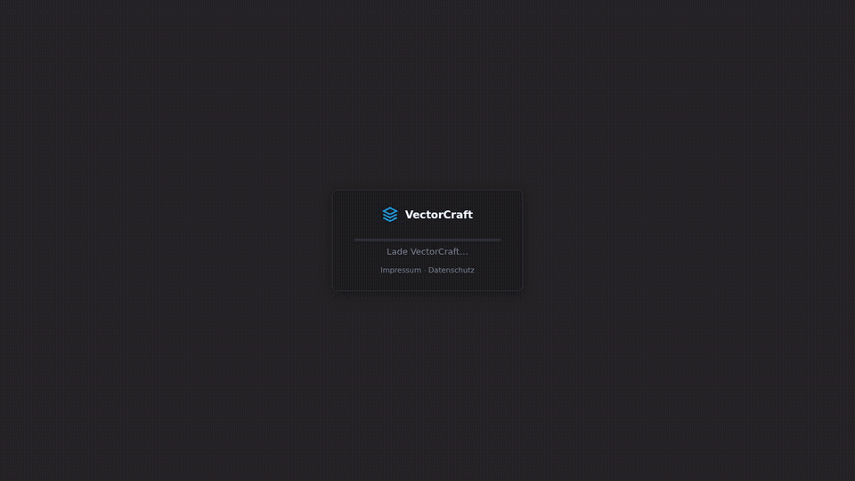

# VectorCraft — Multiplayer & Remote AI Edition

<p align="center">
  <b>Production-ready, collaborative multiplayer vector illustration & remote AI canvas.</b><br>
  <sub>An extended fork of <a href="https://github.com/storytold/vectorcraft">storytold/vectorcraft</a> by <b>C4NDY Digital</b>.</sub>
</p>

<p align="center">
  <a href="https://vector.c4ndy.com"></a>
</p>

<p align="center">
  
  
  
  
  
  
</p>

<p align="center">
  
  <br><sub><b>Real-time collaboration in action:</b> Live peer cursors moving across the canvas while an AI agent constructs the c4ndy logo via remote MCP & CRDT sync.</sub>
</p>

---

## About this Fork

**VectorCraft** was originally created by the [ArtCraft Team (storytold)](https://github.com/storytold/vectorcraft) as a clean-room reimplementation of Adobe Illustrator in pure Rust.

This **C4NDY Digital fork** extends VectorCraft into a production-ready, cloud-native collaborative workspace where **human teams and autonomous AI agents collaborate in real-time on the same vector canvas**.

> [!NOTE]
> **Looking for the core desktop application, feature parity benchmarks, or drawing tools documentation?**  
> Visit the upstream repository: **[github.com/storytold/vectorcraft](https://github.com/storytold/vectorcraft)**.  
> This README specifically documents the multiplayer architecture, AI integrations, self-hosted deployment, and fork-specific configurations.

---

## Key Fork Features

### 1. 👥 Real-Time Multiplayer Collaboration
* **CRDT Document Sync:** Powered by `Yrs` (Rust port of Yjs). Shapes, layers, artboards, z-order, and ruler guides synchronize conflict-free across all connected peers.
* **Ephemeral Presence (60 FPS):** Live remote cursors with peer names, color-coded selection bounding boxes, and drag/transform ghost previews without bloating document history.
* **Room Security & Cryptographic Tokens:** Rooms use unguessable 12-character cryptographic IDs (`c4ndy-xxxxxxxxxxxx`) with optional PIN/password protection.
* **Browser Shortcut Overrides:** WebAssembly builds intercept Illustrator keybindings (such as `Ctrl+R` for Rulers, `Ctrl+S`, `Ctrl+Z`, `Ctrl+D`) to prevent unwanted browser reloads or actions.

### 2. 🤖 Remote Model Context Protocol (MCP) for AI Agents
* **Zero-Config Remote MCP Server:** Integrated directly into `vectorcraft-server`.
* **Real-time AI Canvas Manipulation:** AI agents (Claude, Gemini, etc.) connect via SSE (`/mcp/sse?room=...`) or HTTP JSON-RPC (`/mcp`) to inspect layers, draw shapes, run batch commands, and collaborate alongside human designers.
* **Interactive In-App MCP Guide:** One-click room connection instructions directly accessible from the in-app Help menu.

### 3. 🛡️ Privacy-First & DSGVO (GDPR) Compliance
* **Zero External Font Leaks:** 100% self-hosted, on-demand caching proxy for Google Fonts and Fontsource (`/fonts/...`). Client browsers never leak IP addresses or tracking cookies to external CDNs.
* **Ephemeral In-Memory Rooms:** By default, room state lives strictly in server RAM while peers are connected and is purged automatically after an idle grace period.
* **Integrated Legal Dialogs:** Built-in modal dialogs for Impressum (§ 5 DDG) and Privacy Policy (DSGVO), configurable via environment variables.
* **Cookieless Analytics:** Optional integration with self-hosted Umami analytics.

### 4. 🚀 Production-Ready Cloud Deployment
* **Coolify & Docker Native:** Multi-stage Dockerfile and native health checks ready for 1-click PaaS deployment.
* **Self-Healing Resource Protection:** Background reaper task monitors memory usage (cgroups v2 & process RSS) and purges inactive rooms.

---

## Configuration & Environment Variables

All settings can be configured via environment variables (e.g. in your **Coolify Project Settings** or `.env` file):

### Server & Network
| Variable | Default | Description |
|---|---|---|
| `PORT` | `8767` | Port for HTTP, WebSocket, and MCP endpoints. |
| `BIND` | `0.0.0.0` | Network interface to bind to. |
| `DIST_PATH` | `dist/web` | Filesystem path to the compiled WebAssembly static bundle. |
| `RUST_LOG` | `info` | Log verbosity (`error`, `warn`, `info`, `debug`, `trace`). |

### Collaboration & Room Lifecycle
| Variable | Default | Description |
|---|---|---|
| `ROOM_GRACE_SECONDS` | `300` (5 min) | **How long an empty room is kept in memory before being purged.** (e.g., `86400` for 24h). |
| `MAX_ROOMS` | `1000` | Maximum number of concurrent active rooms held in server RAM. |
| `MAX_CLIENTS_PER_ROOM` | `50` | Maximum simultaneous peers connected to a single room. |
| `MAX_ROOM_BYTES` | `52428800` (50 MB)| Maximum allowed CRDT document + blob size per room. |
| `MAX_MESSAGE_BYTES` | `10485760` (10 MB)| Maximum allowed WebSocket packet payload size. |

### Legal & DSGVO / GDPR
| Variable | Default | Description |
|---|---|---|
| `LEGAL_COMPANY` | - | Company / Operator name displayed in Impressum. |
| `LEGAL_REPRESENTATIVE` | - | Authorized representative / Managing Director. |
| `LEGAL_STREET` / `LEGAL_CITY` | - | Address details. |
| `LEGAL_EMAIL` / `LEGAL_PHONE` | - | Contact information. |
| `LEGAL_REGISTER_COURT` / `LEGAL_REGISTER_NUMBER` | - | Commercial register details. |
| `LEGAL_VAT_ID` | - | VAT identification number (USt-IdNr.). |

### Analytics & Monitoring (Optional)
| Variable | Default | Description |
|---|---|---|
| `UMAMI_SCRIPT_URL` | - | URL to self-hosted Umami tracking script. |
| `UMAMI_WEBSITE_ID` | - | Umami Website ID (cookieless analytics). |
| `METRICS_TOKEN` | - | Bearer token protecting `/metrics` and `/status` endpoints. |
| `ALERT_MEM_PERCENT` | `80` | Memory usage threshold (%) to trigger an alert. |
| `ALERT_ROOMS_PERCENT`| `80` | Room limit capacity threshold (%) to trigger an alert. |
| `ALERT_WEBHOOK_URL` | - | Webhook URL (Slack/Discord) for automated server resource alerts. |

### Self-Hosted Font CDN Proxy (DSGVO / GDPR)
| Variable | Default | Description |
|---|---|---|
| `FONTS_PROXY_ENABLED` | `true` | When true, caches Google/Fontsource fonts locally on the server. |
| `FONTS_CACHE_DIR` | `/app/fonts_cache` | Local directory for cached font binaries (`.woff2`, `.ttf`). |
| `FONTS_CDN_UPSTREAM` | `https://cdn.jsdelivr.net/...` | Upstream open-source font CDN fallback. |

> [!TIP]
> A complete, ready-to-copy template with all available environment variables and detailed comments is available in **[`.env.example`](.env.example)**.

---

## Quick Start

### 1. Run the Collaborative Server Locally (Docker / Cargo)

Using Cargo:
```bash
# Build the WebAssembly frontend
cd apps/vectorcraft-web && trunk build --release && cd ../..

# Start the collaborative server
cargo run --release -p vectorcraft-server
```
Visit `http://localhost:8767` in your browser.

Using Docker:
```bash
docker build -t vectorcraft-server .
docker run -p 8767:8767 -e ROOM_GRACE_SECONDS=86400 vectorcraft-server
```

### 2. Connect an AI Agent via MCP

Add the remote room endpoint to your Claude or AI agent configuration:
```json
{
  "mcpServers": {
    "vectorcraft": {
      "url": "https://vector.c4ndy.com/mcp/sse?room=c4ndy-myroom"
    }
  }
}
```

---

## Upstream Synchronization & Architecture

We maintain this repository with clean upstream separation so features and bug fixes from [storytold/vectorcraft](https://github.com/storytold/vectorcraft) can be continuously merged.

For architecture details, CRDT synchronization mechanics, and upstream merge workflows, please refer to:
* 📖 **[Fork Architecture & Upstream Merge Guide](docs/FORK_MERGE_GUIDE.md)**

---

## Credits & Attribution

* **Original VectorCraft Project:** Created by the [ArtCraft Team](https://getartcraft.com) and the [VectorCraft contributors](https://github.com/storytold/vectorcraft).
* **Multiplayer, MCP & Cloud Architecture:** Developed by **C4NDY Digital** ([Adrian Jehne](https://github.com/c4ndydigital)) & AI pair programming agents.
* **Core Illustrator Parity & Pure Rust Engine:** See upstream [storytold/vectorcraft](https://github.com/storytold/vectorcraft) for the original codebase, contributors, and illustration features.

Dual-licensed under [MIT](LICENSE-MIT) OR [Apache-2.0](LICENSE-APACHE).
